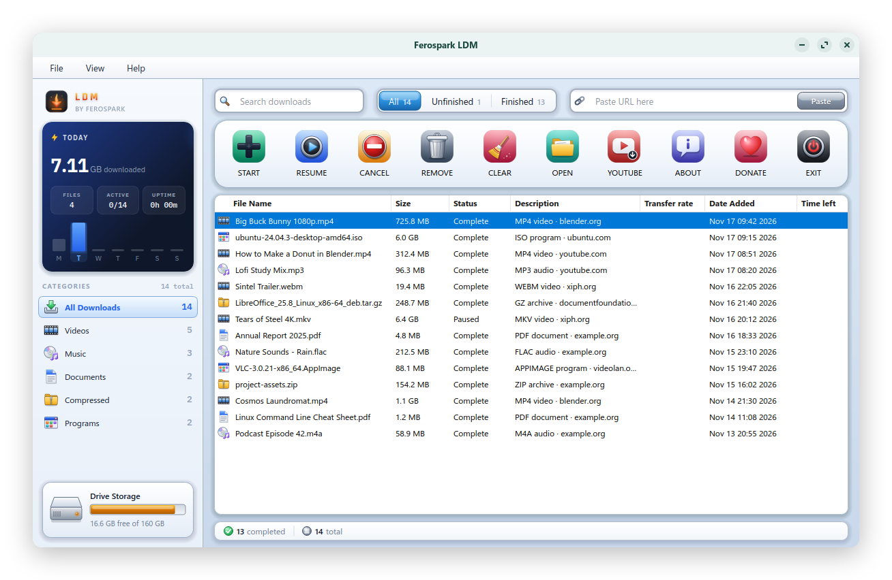
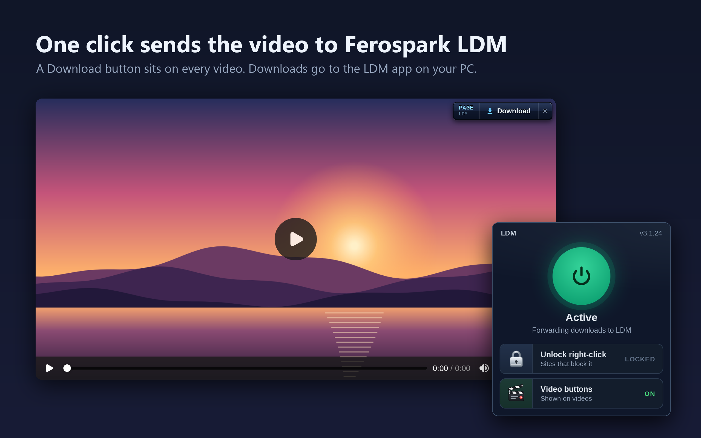
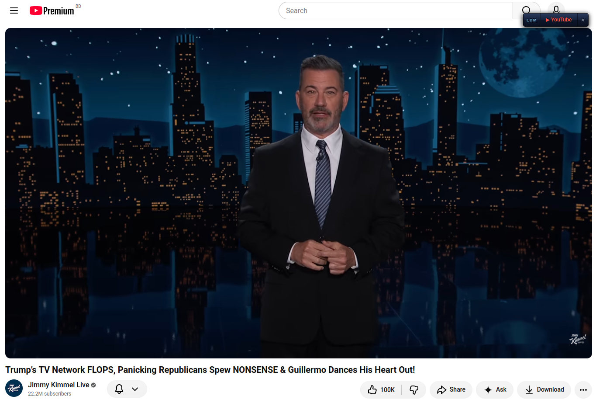
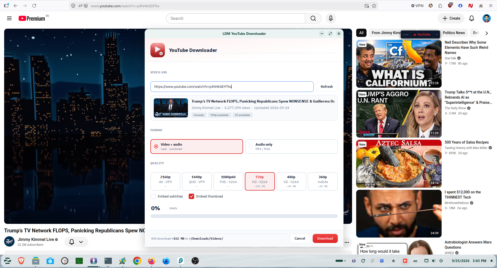
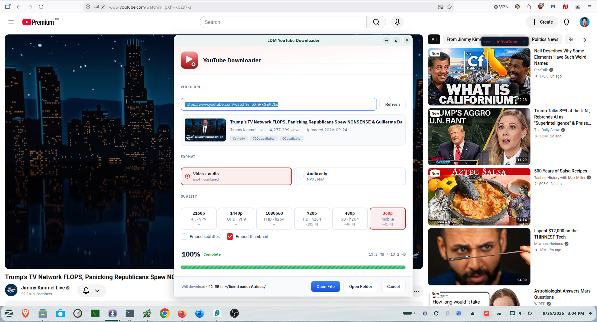
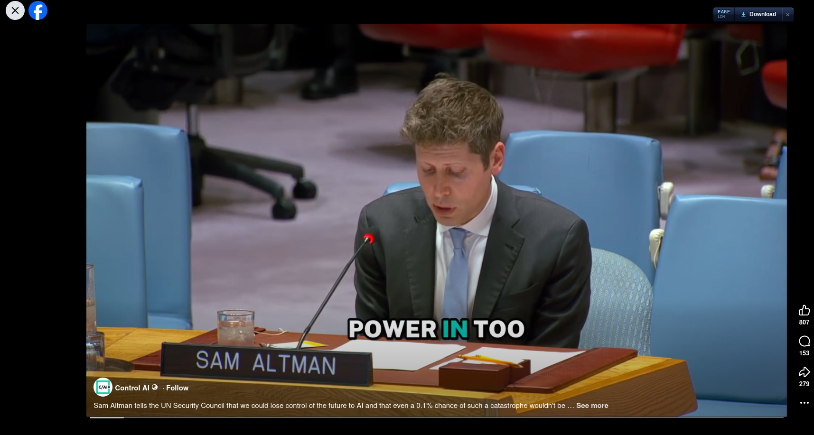
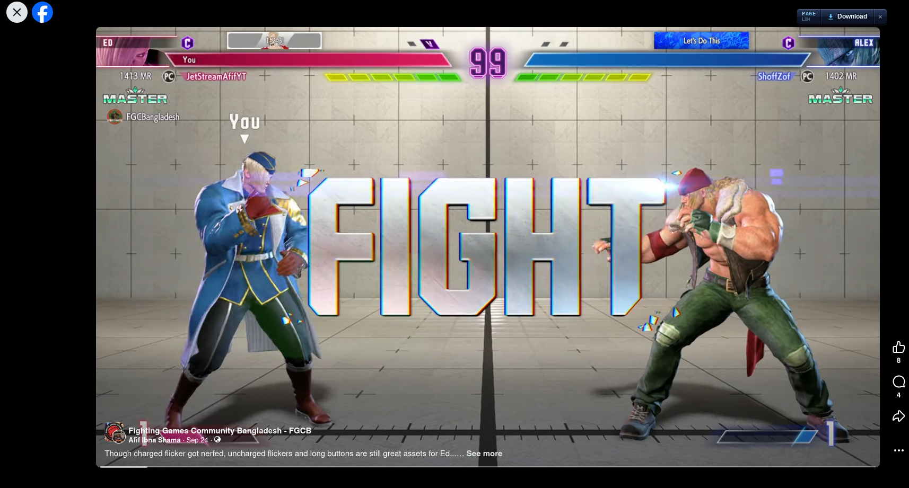
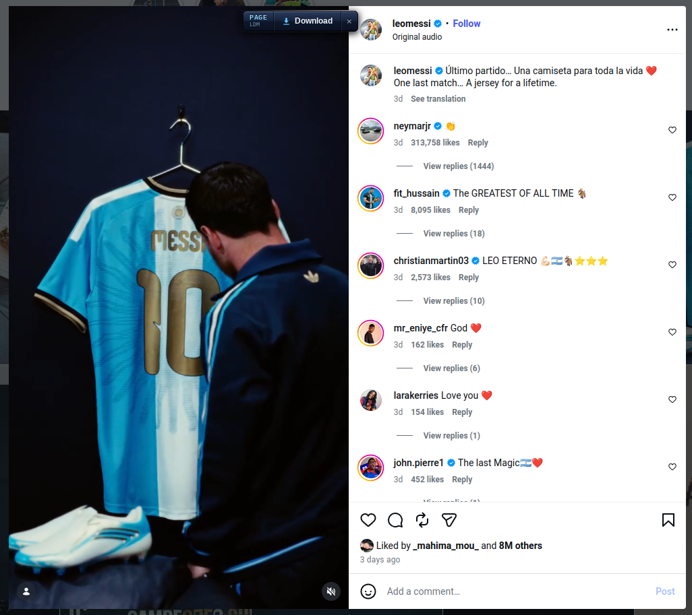
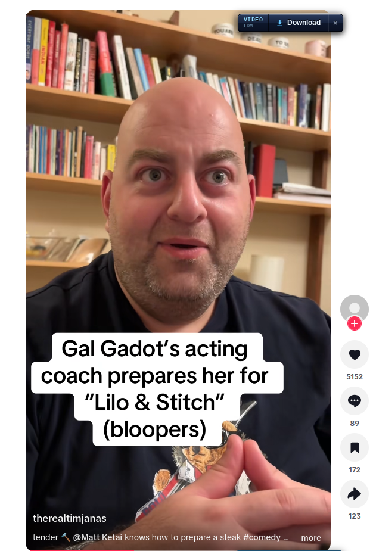
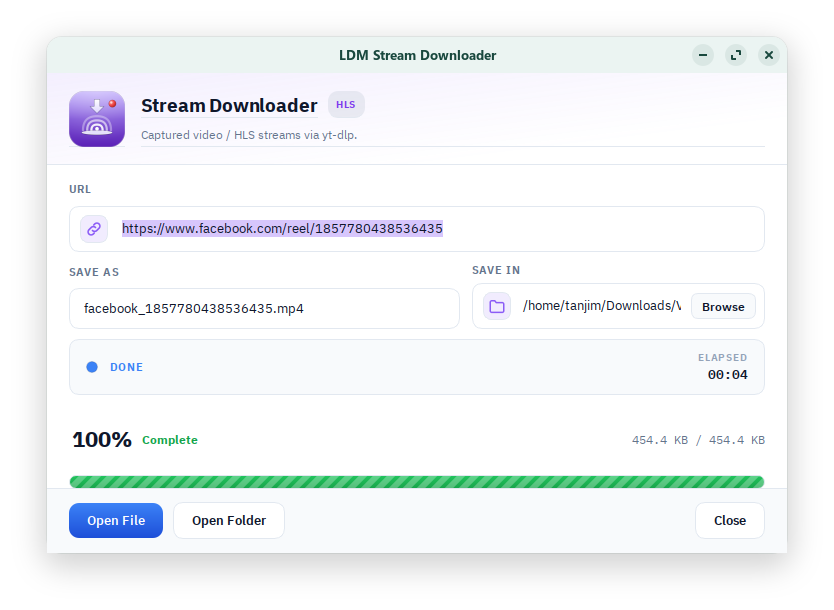

# Ferospark LDM

A download manager for Linux. It takes over your Firefox downloads, grabs videos from most sites, downloads from YouTube, and sorts everything into folders for you.


---

## Screenshots

### Main window


### Firefox extension


### YouTube






### Videos from other sites

**Facebook**


**Facebook Gaming**


**Instagram**


**TikTok**


### Stream downloader


---

## What it does

- **Takes over Firefox downloads.** When you click a download link, the file goes to LDM instead of Firefox.
- **Download button on videos.** A small Download button shows up in the corner of videos on most sites (Facebook, Instagram, TikTok, Reddit and many more). One click sends the video to LDM.
- **YouTube.** Pick a quality (Best, 1080p, 720p, 480p, 360p) or save just the audio as mp3, m4a, flac, wav, ogg or aac.
- **Sorted for you.** Files land in Videos, Music, Documents, Compressed, Programs or Others.
- **A list you can read at a glance.** Name, size, status, speed and time left for every download, in a layout that will feel familiar if you have used IDM.
- **Warns about repeats.** If you start a download you already have, LDM tells you first.
- **Unlocks right-click.** Some sites block right-click to stop you saving things. The extension can switch that back on.
- **Right-click a link** in Firefox and choose *Download with Linux Manager*.
- **Pause it anytime.** The power button in the extension popup lets Firefox handle downloads again until you turn it back on.
- **Light and dark mode.**
- **Stays in the tray.** Closing the window keeps downloads running.
- **Starts with your computer.** Turn on **View → Start with System** and LDM starts in the tray when you log in, ready for the browser, without opening its window.

---

## Requirements

- Linux (Ubuntu or Debian based; tested on Zorin OS)
- Python 3.10 or newer
- Firefox, or Chrome and other Chromium browsers (Brave, Edge)

---

## Installation

### 1. Get the code

```bash
git clone https://github.com/matewinslet/LinuxDownloader.git
cd LinuxDownloader
```

### 2. Run the installer

```bash
chmod +x install.sh
./install.sh
```

The installer sets up everything LDM needs:
- ffmpeg and curl
- The Python packages (PyQt6, requests, yt-dlp, curl_cffi, pycryptodome)
- Deno, which YouTube downloads need
- The app icon and a menu entry

### 3. Add the Firefox extension

Get it from Firefox Add-ons:

[Ferospark LDM on Firefox Add-ons](https://addons.mozilla.org/en-US/firefox/addon/49cdbb655b5d47a7bce3/)

You can also download the `.xpi` file from the [Releases](https://github.com/matewinslet/LinuxDownloader/releases) page and drag it into Firefox.

### Using Chrome instead

LDM works with Chrome too, and with other Chromium browsers such as Brave and Edge. The Chrome extension isn't on the Chrome Web Store, so you add it by hand:

1. Open `chrome://extensions` (in Brave, `brave://extensions`).
2. Turn on **Developer mode** in the top-right corner.
3. Click **Load unpacked** and pick the `chrome-extension` folder inside the LDM folder you cloned.

If you installed LDM from a package instead, download `ferospark-ldm-chrome-3.1.25.zip` from the [Releases](https://github.com/matewinslet/LinuxDownloader/releases) page, unzip it, and pick that folder in step 3.

Leave the folder where it is. Chrome loads the extension from it each time it starts.

---

## How to use it

### Normal downloads
1. Open **Ferospark LDM** from your app menu.
2. Click any download link in Firefox. The file shows up in LDM.

### Videos
1. Play or open a video on the site.
2. Click **Download** in the video's top-right corner.

If you don't want the button on a page, click its **×**. To hide it everywhere, open the extension popup and turn off **Video buttons**.

### YouTube
1. Open a video on YouTube.
2. Click the **YouTube** button in the corner of the player.
3. Choose the quality or audio format and click **Download**.

You can also paste a YouTube link into the URL box in LDM and press **Download**.

### Start LDM when you log in
Open **View → Start with System**. From then on LDM starts quietly in the tray each time you log in, so the browser extension works without you opening the app first. Click the tray icon when you want the window. Turn the same switch off to stop it.

If your desktop has no tray (plain GNOME without an AppIndicator extension), LDM opens its window at login instead, so you can still reach it.

---

## Installing by hand

If you'd rather not use the installer:

```bash
# 1. System packages
sudo apt install -y ffmpeg curl

# 2. Python packages
# Keep curl_cffi below 0.15: yt-dlp turns off browser impersonation on 0.15 and newer.
pip install PyQt6 requests yt-dlp "curl_cffi>=0.10,<0.15" pycryptodome --break-system-packages

# 3. Deno (for YouTube)
curl -fsSL https://deno.land/install.sh | sh
sudo ln -sf ~/.deno/bin/deno /usr/local/bin/deno
```

Then start it:

```bash
chmod +x download_manager.py
python3 download_manager.py
```

---

## Updating

```bash
cd LinuxDownloader
git pull
```

If YouTube downloads stop working, use **Update yt-dlp** in the YouTube Downloader window.

---

## What it's built on

| Package | Used for |
|---------|----------|
| PyQt6 | The app window |
| requests | Regular downloads |
| yt-dlp | YouTube and other video sites |
| curl_cffi (>=0.10,<0.15) | Looking like a real browser to sites that check (Lulu, for example) |
| pycryptodome | Decrypting encrypted video streams |
| ffmpeg | Joining video and audio |
| curl | Backup downloader for difficult sites |
| Deno | Solving YouTube's player code |

---

## Support

Something not working? Email **tpodbcs@gmail.com**.

---

## License

MIT License. Copyright (c) 2026 Tanjim.
See [LICENSE.txt](LICENSE.txt) for details.
